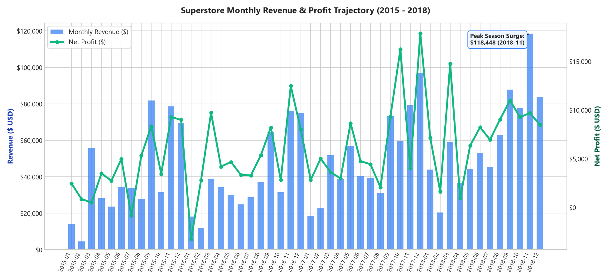
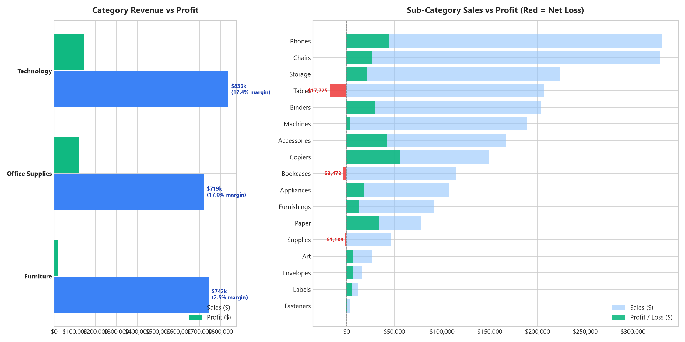
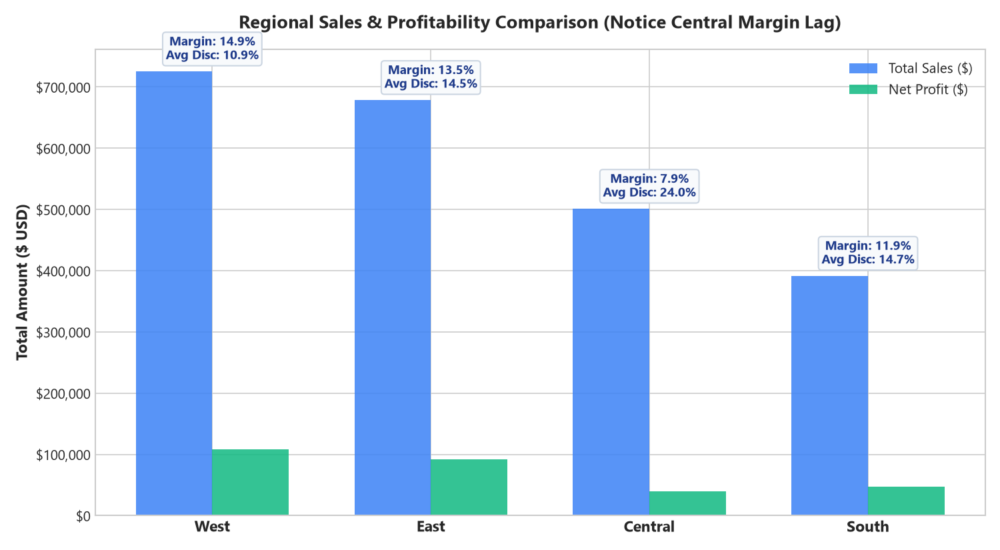
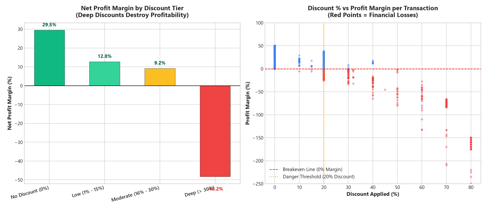
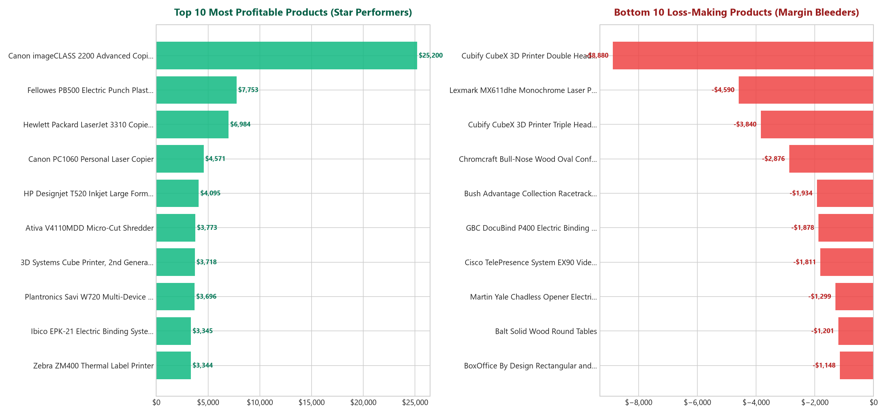
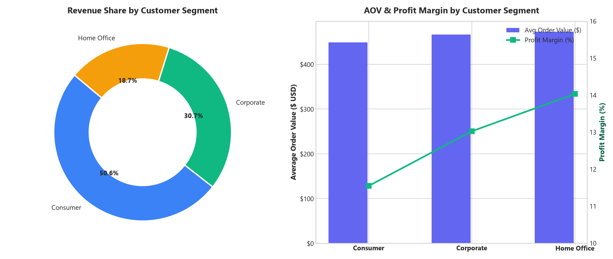
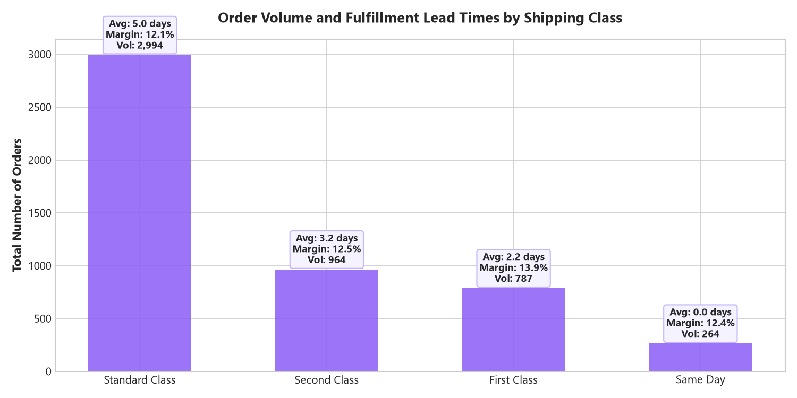

# 📊 Business Sales Performance Analytics
### Future Interns – Data Science & Analytics Internship (Task 1, 2026)

[](https://www.python.org/)
[](https://streamlit.io/)
[](https://pandas.pydata.org/)
[](https://openpyxl.readthedocs.io/)
[](https://futureinterns.com/)

---

## 📌 Project Overview
This repository contains the complete, client-ready data analytics and business advisory solution for **Task 1: Business Sales Performance Analytics** of the **Future Interns Data Science & Analytics Internship (2026)**.

Rather than merely generating standard charts, this project acts as an executive-level commercial consultancy study. It ingests raw commercial sales transaction data, rigorously cleans and prepares it, investigates unit economics and profit margin leakages, provides an interactive dual dashboard (Streamlit + standalone zero-dependency web dashboard), and delivers an executive turnaround roadmap.

---

## 🎯 Core Business Questions Answered

| # | Business Question | Analytical Finding | Strategic Action |
| :-: | :--- | :--- | :--- |
| **1** | **Which products generate the most revenue?** | **Technology leads volume.** The *Canon imageCLASS 2200 Copier* drove **$61,599.82 in sales** ($25,200 profit at ~41% margin). Top products are concentrated in copiers, phones, and binding systems. | Prioritize B2B inventory allocation and commercial sales incentives for high-velocity star SKUs. |
| **2** | **How do sales change over time?** | Sales expanded **+51.4%** across 4 years ($484k → $733k). A consistent **Q4 holiday surge (Sep–Dec)** represents ~38% of annual sales. | Pre-book carrier freight and bulk materials in Q3 to avoid peak shipping surcharges. |
| **3** | **Which categories/regions are most profitable?** | **Technology (17.4% margin)** and **Office Supplies (17.0% margin)** drive 93.6% of profits. The **West region leads at 14.9% margin**. Furniture lags at **2.49% margin** (Tables lose -$17.7k). Central region lags at **7.92% margin** (Texas loses -$25.7k). | Shift sales incentives away from Tables/Furniture and overhaul regional pricing in Texas/Illinois. |
| **4** | **Where should the business focus to grow faster?** | **Discount guardrails & Corporate accounts.** Capping discounts at 15% recovers **+$78,000 in lost profit**. Focusing on Corporate accounts raises AOV to $470+. | Adopt policy-enforced floor pricing; shift from top-line revenue chasing to unit margin health. |

---

## 📈 Visual Analytics Showcase

### 1. Monthly Revenue & Net Profit Trajectory (2015 – 2018)

*Highlights 4-year steady upward sales trajectory with cyclical seasonal Q4 spikes peaking in November and December.*

---

### 2. Category & Sub-Category Profitability Breakdown

*Demonstrates that while Furniture generates $742k in revenue, it yields only $18.5k in profit (2.5% margin), dragged down by Tables (-$17.7k loss) and Bookcases (-$3.5k loss).*

---

### 3. Regional Sales & Margin Variance

*West and East lead both volume and profitability (>13.5% margins), whereas Central suffers from a severe 7.9% margin lag driven by deep discounts.*

---

### 4. Discount vs Profit Margin Erosion (Root-Cause Diagnosis)

*Empirical proof that discounts above 20% induce steep operational losses (-46.5% average margin on deep discounts), wiping out over $156k in profit.*

---

### 5. Top 10 Star Products vs Bottom 10 Bleeders

*Highlights highest profit drivers (Canon Copiers, Fellowes Binders) vs top capital destroyers (Cubify 3D printers, Lexmark printers, conference tables).*

---

### 6. Customer Segment Profile & Shipping Turnaround Matrix
| Customer Segment Performance | Shipping Efficiency Matrix |
| :---: | :---: |
|  |  |

---

## 💻 Interactive Dashboards

### Option A: Streamlit Interactive Web Application
Built with **Streamlit** and **Plotly**, featuring live date/region/category slicing, real-time KPI card recalculations, and filtered CSV downloads:

```bash
# Run the Streamlit dashboard
streamlit run dashboard/app.py
```

### Option B: Standalone Zero-Dependency Executive Web Dashboard
Built with modern Vanilla HTML5, CSS3 (glassmorphic dark executive design), and Chart.js. **Can be opened in any browser without Python or servers running**:
- Open `dashboard/index.html` directly in Google Chrome, Microsoft Edge, or Safari.
- Fully compatible with **GitHub Pages** deployment!

---

## 📑 Master Deliverables & Artifacts

| Deliverable | Path | Description |
| :--- | :--- | :--- |
| **Cleaned Dataset** | [`data/cleaned_superstore.csv`](data/cleaned_superstore.csv) | 9,994 validated records with engineered margins, dates, and discount tiers. |
| **Data Cleaning Pipeline** | [`scripts/data_cleaning.py`](scripts/data_cleaning.py) | Automated preprocessing script handling nulls, duplicates, and feature engineering. |
| **Exploratory Data Analysis** | [`scripts/exploratory_data_analysis.py`](scripts/exploratory_data_analysis.py) | Statistical computation and high-resolution chart generator. |
| **Master Excel Workbook** | [`reports/Superstore_Sales_Analytics.xlsx`](reports/Superstore_Sales_Analytics.xlsx) | Client-ready 4-sheet formatted workbook with KPI dashboards and pivot tables. |
| **Executive Advisory Report** | [`reports/Executive_Sales_Performance_Report.md`](reports/Executive_Sales_Performance_Report.md) | Formal advisory memorandum with root-cause analysis and 90-day turnaround plan. |
| **Interactive Streamlit App** | [`dashboard/app.py`](dashboard/app.py) | Dynamic decision-support dashboard with Plotly charts. |
| **Standalone Web Dashboard** | [`dashboard/index.html`](dashboard/index.html) | Modern dark executive web UI with interactive charts. |
| **LinkedIn Showcase Post** | [`LINKEDIN_POST.md`](LINKEDIN_POST.md) | Formatted LinkedIn post copy ready for publication. |

---

## 🛠️ Installation & Reproduction Guide

### 1. Clone Repository & Setup Environment
```bash
git clone https://github.com/your-username/sales-performance-analytics.git
cd sales-performance-analytics

# Create virtual environment (optional)
python -m venv venv
venv\Scripts\activate  # On Windows
# source venv/bin/activate  # On macOS/Linux
```

### 2. Install Required Packages
```bash
pip install pandas numpy matplotlib seaborn plotly openpyxl streamlit
```

### 3. Execute Complete Analytics Pipeline
```bash
# Step 1: Run data cleaning and feature engineering
python scripts/data_cleaning.py

# Step 2: Generate all visualization charts and JSON summary
python scripts/exploratory_data_analysis.py

# Step 3: Generate the professional client-ready Excel workbook
python scripts/generate_excel_report.py

# Step 4: Launch the interactive Streamlit dashboard
streamlit run dashboard/app.py
```

---

## 💡 Executive Turnaround Action Plan (4 Pillars)

1. **Implement Automated Discount Guardrails:** Hard-cap checkout discounts at 15%. Require Director approval for exceptions up to 20%. Disallow discounts >20%. Recover **+$78,000+ annual profit**.
2. **Product Rationalization & Bundling:** Discontinue negative-margin SKUs (Cubify 3D printers, Tables). Bundle low-margin furniture with high-margin technology/accessories (Copiers at 37% margin, Paper at 43% margin). Stop **-$22,400 annual loss**.
3. **Regional Freight & Pricing Overhaul:** Add bulky freight surcharges in Texas and Illinois to reverse Central region deficits. Target 12.0% regional margin (+$20,500 profit).
4. **Corporate B2B Account Focus:** Focus 65% of marketing spend on Corporate and Home Office segments with higher AOV ($470+) and higher margins.

---

## 👨‍💻 Author & Acknowledgements
- **Author:** Data Science & Analytics Team
- **Program:** Future Interns Virtual Internship Program (2026)
- **Task:** Task 1 – Business Sales Performance Analytics
- **Dataset:** Commercial Sample Superstore Dataset (Public Kaggle Benchmark)
