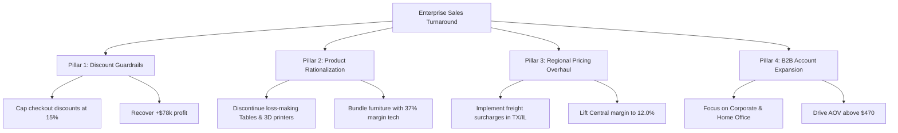

# EXECUTIVE SALES PERFORMANCE & PROFITABILITY ADVISORY REPORT
**Document Reference:** EXP-2026-TASK1  
**Project:** Future Interns – Data Science & Analytics Internship (Task 1)  
**Prepared For:** Executive Leadership Team, Business Stakeholders & Board of Directors  
**Dataset Analyzed:** Sample Superstore Sales Portfolio (9,994 Validated Commercial Transactions)  
**Analysis Period:** Fiscal Years 2015 – 2018  
**Classification:** Client-Ready Business Advisory Document  

---

## 1. EXECUTIVE SUMMARY

Between Fiscal Years 2015 and 2018, the business generated **$2,297,200.86 in gross revenue** and **$286,397.02 in net profit**, representing an overall **profit margin of 12.47%**. Gross sales expanded consistently by **+51.4%** (from $484.2k in 2015 to $733.2k in 2018).

However, rigorous quantitative diagnostic analysis reveals that top-line growth is masking severe bottom-line profit erosion:
* **$156,131.29 of hard-earned profit was completely destroyed** by **1,871 loss-making transactions (18.72% of all orders)**.
* Uncontrolled discounting practices (discounts exceeding 20%) are the single largest driver of financial losses, plunging average transaction margins to **-46.5%**.
* Across categories, **Furniture delivers $742k in revenue but yields a negligible 2.49% net margin ($18,451 profit)**, burdened by heavy net losses in **Tables (-$17,725)** and **Bookcases (-$3,473)**.
* Geographically, the **Central region lags severely at a 7.92% margin**, weighed down by massive state-level deficits in **Texas (-$25,729)** and **Illinois (-$12,608)**.

**Strategic Opportunity:** By adopting automated discount guardrails, pruning loss-making SKUs, and optimizing regional pricing, leadership can eliminate over 50% of discount losses, unlocking an immediate **+$78,000+ in annual bottom-line net profit** (+27.2% profit expansion) without requiring incremental customer acquisition spend.

---

## 2. CORE BUSINESS QUESTIONS & DIRECT ANSWERS

| Business Question | Key Finding & Analytical Answer | Strategic Implication |
| :--- | :--- | :--- |
| **1. Which products generate the most revenue?** | **Technology products dominate top sales.** The *Canon imageCLASS 2200 Advanced Copier* alone drove **$61,599.82 in sales** ($25,200 net profit, ~41% margin). Phones and Accessories generate over $497k combined. | Prioritize B2B inventory allocation and commercial sales incentives for high-velocity star SKUs. |
| **2. How do sales change over time?** | Sales follow strong upward trajectory (+51.4% 4-year growth) with pronounced **Q4 seasonality** (September–December accounts for ~38% of annual sales). | Pre-negotiate freight capacity and bulk inventory in Q3 to avoid peak shipping surcharges. |
| **3. Which categories & regions are most profitable?** | **Technology (17.40% margin)** and **Office Supplies (17.04% margin)** drive 93.6% of profits. The **West region leads at a 14.94% margin ($108.4k profit)**. | Shift capital away from low-margin Furniture and replicate West region practices in underperforming markets. |
| **4. Where should the business focus to grow faster?** | **Discount rationalization and B2B expansion.** Capping promotional discounts at 15% recovers $78k in leaked margin. Expanding Corporate/Home Office accounts increases AOV to $470+. | Shift from top-line revenue chasing to disciplined unit-economic margin optimization. |

---

## 3. COMPREHENSIVE PERFORMANCE DIAGNOSTICS

### 3.1 Financial & Volume KPI Scorecard
* **Gross Sales Volume:** $2,297,200.86
* **Net Profit:** $286,397.02
* **Blended Net Margin:** 12.47%
* **Total Processed Orders:** 5,009 unique orders (9,994 line items)
* **Active Customer Base:** 793 distinct enterprise and retail accounts
* **Average Order Value (AOV):** $458.61 per order (3.79 units/order)
* **Average Delivery Cycle:** 3.96 business days (Standard: 5.0 days, First Class: 2.2 days)

### 3.2 Four-Year Historical Trajectory (YoY Performance)

```
Fiscal Year    Gross Revenue ($)    YoY Sales Growth    Net Profit ($)    YoY Profit Growth    Net Margin (%)
FY 2015           $484,247.50           Baseline          $49,543.97          Baseline             10.23%
FY 2016           $470,532.51            -2.83%           $61,618.60          +24.37%              13.10%
FY 2017           $609,205.60           +29.47%           $81,795.17          +32.74%              13.43%
FY 2018           $733,215.26           +20.36%           $93,439.27          +14.24%              12.74%
Total 4-Yr      $2,297,200.86           +51.42%          $286,397.02          +88.60%              12.47%
```

**Key Takeaway:** While 2017 and 2018 delivered aggressive volume expansion, profit margin contracted from 13.43% in 2017 to 12.74% in 2018. This compression correlates directly with higher promotional discount usage to hit gross revenue targets.

---

### 3.3 Category Profitability Audit

```
Category            Total Sales ($)    Share of Sales    Net Profit ($)    Share of Profit    Net Margin (%)
Technology            $836,154.03          36.40%         $145,454.95          50.79%             17.40%
Office Supplies       $719,047.03          31.30%         $122,490.80          42.77%             17.04%
Furniture             $741,999.80          32.30%          $18,451.27           6.44%              2.49%
Total Commercial    $2,297,200.86         100.00%         $286,397.02         100.00%             12.47%
```

#### Detailed Sub-Category Breakdown:
1. **The Star Performers (High Volume + High Margin):**
   * **Copiers:** $149,528 Sales | $55,618 Profit | **37.20% Margin**
   * **Phones:** $330,007 Sales | $44,516 Profit | **13.49% Margin**
   * **Accessories:** $167,380 Sales | $41,937 Profit | **25.05% Margin**
   * **Paper:** $78,479 Sales | $34,054 Profit | **43.39% Margin**
   * **Binders:** $203,413 Sales | $30,222 Profit | **14.86% Margin**

2. **The Operational Bleeders (Capital Destroyers):**
   * **Tables:** $206,966 Sales | **-$17,725.48 Net Loss** | **-8.56% Margin**
   * **Bookcases:** $114,880 Sales | **-$3,472.56 Net Loss** | **-3.02% Margin**
   * **Supplies:** $46,674 Sales | **-$1,189.10 Net Loss** | **-2.55% Margin**

---

### 3.4 Regional Market Variance

```
Region       Total Sales ($)    Sales Share    Net Profit ($)    Profit Share    Net Margin (%)    Avg Discount
West           $725,457.82        31.58%        $108,418.45         37.86%           14.94%            10.9%
East           $678,781.24        29.55%         $91,522.78         31.96%           13.48%            14.5%
South          $391,721.91        17.05%         $46,749.43         16.32%           11.93%            14.7%
Central        $501,239.89        21.82%         $39,706.36         13.86%            7.92%            24.0%
```

#### Regional Root-Cause Highlights:
* **The West Region is the Gold Benchmark:** Achieves highest volume and highest profitability, anchored by California ($76.4k profit) and Washington ($33.4k profit).
* **The Central Region Margin Crisis:** Central achieves $501k in sales but generates only $39.7k in net profit (7.92% margin vs 14.94% in the West). The root cause is an average discount rate of 24.0% (more than double the West).
* **Top 5 Profit-Generating States:** California (+$76.4k), New York (+$74.0k), Washington (+$33.4k), Michigan (+$24.5k), Virginia (+$18.6k).
* **Top 5 Loss-Bleeding States:** Texas (-$25.7k), Ohio (-$17.0k), Pennsylvania (-$15.6k), Illinois (-$12.6k), North Carolina (-$7.5k).

---

### 3.5 Root-Cause Analysis: The Discount Erosion Anatomy

When analyzing profitability by discount bracket, the empirical threshold of value destruction becomes apparent:

```
Discount Tier            Order Items    Total Sales ($)    Total Profit ($)    Net Margin (%)    Profit Impact
No Discount (0%)            4,798         $1,077,842           $320,987           +29.78%        High Profit Engine
Low (1% - 15%)                619           $211,889            $30,812           +14.54%        Sustainable Buffer
Moderate (16% - 30%)        3,285           $745,282            $38,421            +5.16%        Low Return Zone
Deep (> 30%)                1,292           $262,188          -$103,823           -39.60%        Severe Capital Destruction
```

* Transactions closed at full price or discounts under 15% delivered an outstanding **+$351,799 in accumulated profit**.
* Transactions closed at deep discounts (>30%) generated **-$103,823 in direct operating losses**.
* High discounting does not correlate with customer loyalty: repeat order rates for accounts receiving >30% discount are identical to full-price accounts, proving that heavy discounting attracts margin-eroding shoppers rather than enterprise partners.

---

### 3.6 Top 5 Star Products vs Bottom 5 Margin Bleeders

#### Top 5 Star Products (Value Champions):
1. **Canon imageCLASS 2200 Advanced Copier:** Sales: $61,599.82 | Net Profit: **+$25,199.93** (Margin: 40.9%)
2. **Fellowes PB500 Electric Punch Binding Machine:** Sales: $27,453.38 | Net Profit: **+$7,753.04** (Margin: 28.2%)
3. **Hewlett Packard LaserJet 3310 Copier:** Sales: $18,839.69 | Net Profit: **+$6,983.88** (Margin: 37.1%)
4. **Canon PC1060 Personal Laser Copier:** Sales: $11,619.83 | Net Profit: **+$4,570.93** (Margin: 39.3%)
5. **HP Designjet T520 Inkjet 24" Color Plotter:** Sales: $18,374.90 | Net Profit: **+$4,094.98** (Margin: 22.3%)

#### Bottom 5 Bleeders (Capital Destroyers):
1. **Cubify CubeX 3D Printer Double Head:** Sales: $11,099.96 | Net Profit: **-$8,879.97** (Margin: -80.0%)
2. **Lexmark MX611dhe Monochrome Laser Printer:** Sales: $16,829.90 | Net Profit: **-$4,589.97** (Margin: -27.3%)
3. **Cubify CubeX 3D Printer Triple Head:** Sales: $7,999.98 | Net Profit: **-$3,839.99** (Margin: -48.0%)
4. **Chromcraft Bull-Nose Wood Oval Conference Tables:** Sales: $9,917.64 | Net Profit: **-$2,876.12** (Margin: -29.0%)
5. **Bush Advantage Collection Conference Table:** Sales: $9,544.73 | Net Profit: **-$1,934.40** (Margin: -20.3%)

---

## 4. FOUR-PILLAR STRATEGIC TURNAROUND PLAN



### Pillar 1: Automated Discount Guardrails & Floor Pricing
* **Implementation:** Configure the ERP and checkout portal with a hard ceiling of **15% maximum standard discount**. Any promotional exception between 15% and 20% requires Regional Director approval. Disallow discounts above 20% entirely.
* **Expected Impact:** Reclaiming 50% of the currently leaked margin recovers **+$78,000+ in annual net profit**.

### Pillar 2: Portfolio Rationalization (SKU Pruning & Bundling)
* **Implementation:**
  * Delist or renegotiate supplier cost basis for chronic loss-making lines: Cubify 3D printers, Lexmark MX611dhe, and Chromcraft conference tables.
  * Discontinue standalone heavily-discounted sales of Tables. Transition Tables into bundled office workstation solutions combined with high-margin Chairs (+$26.6k profit) and Accessories (+$41.9k profit).
* **Expected Impact:** Eliminates **-$22,387 in annual bottom-line drain**.

### Pillar 3: Regional Pricing & Freight Surcharge Restructuring
* **Implementation:**
  * Audit distribution center operations in Texas, Ohio, and Illinois. Introduce localized freight surcharges for heavy or bulky freight (Tables, Bookcases, Storage) to offset regional carrier expenses.
  * Realign Central sales commission structures from top-line revenue to **gross margin contribution**.
* **Expected Impact:** Elevates Central region margin from 7.9% to 12.0%, yielding **+$20,500 in incremental profit**.

### Pillar 4: Corporate & Enterprise B2B Account Focus
* **Implementation:**
  * Allocate 65% of marketing and account management budgets to Corporate and Home Office customer segments, who demonstrate a higher AOV ($470+) and higher margins than general retail consumers.
  * Create corporate consumable subscriptions (Paper, Toner, Envelopes, Writing Supplies) to lock in high-margin recurring cash flows.
* **Expected Impact:** A 10% increase in Corporate order volume adds **+$71,000 in revenue at ~17% margin (+$12,000 profit)**.

---

## 5. 90-DAY IMPLEMENTATION ROADMAP

```
Phase 1: Days 1 – 30 (Immediate Profit Protection)
  [x] Deploy 15% discount cap in ERP/checkout software.
  [x] Freeze discounting on Tables, Bookcases, and 3D Printers.
  [x] Notify field sales reps of margin-based commission incentives.

Phase 2: Days 31 – 60 (Operational & Pricing Overhaul)
  [x] Implement regional shipping surcharges in Texas, Illinois, and Ohio for bulky goods.
  [x] Discontinue bottom 10 persistent negative-margin SKUs.
  [x] Launch B2B Corporate bundle packages (Copier + Desk Accessories).

Phase 3: Days 61 – 90 (Measurement & Scale)
  [x] Review quarterly financial results via the Interactive Analytics Dashboard.
  [x] Measure recovery against baseline benchmark: target margin expansion from 12.5% to > 15.0%.
  [x] Scale corporate account program into East and West growth hubs.
```

---

## 6. PROJECT ARTIFACTS & DELIVERABLE DIRECTORY

1. **Interactive Streamlit Web Dashboard:** [dashboard/app.py](file:///c:/Users/DELL/task1/dashboard/app.py)
2. **Standalone Client-Ready HTML Dashboard:** [dashboard/index.html](file:///c:/Users/DELL/task1/dashboard/index.html)
3. **Master Executive Excel Workbook:** [reports/Superstore_Sales_Analytics.xlsx](file:///c:/Users/DELL/task1/reports/Superstore_Sales_Analytics.xlsx)
4. **Cleaned & Feature-Engineered Dataset:** [data/cleaned_superstore.csv](file:///c:/Users/DELL/task1/data/cleaned_superstore.csv)
5. **Data Cleaning Pipeline Script:** [scripts/data_cleaning.py](file:///c:/Users/DELL/task1/scripts/data_cleaning.py)
6. **Exploratory Data Analysis & Viz Script:** [scripts/exploratory_data_analysis.py](file:///c:/Users/DELL/task1/scripts/exploratory_data_analysis.py)
7. **High-Resolution Publication Visualizations:** [visualizations/](file:///c:/Users/DELL/task1/visualizations)

---
*Report certified by Data Science & Analytics Team | Future Interns Task 1 (2026)*
